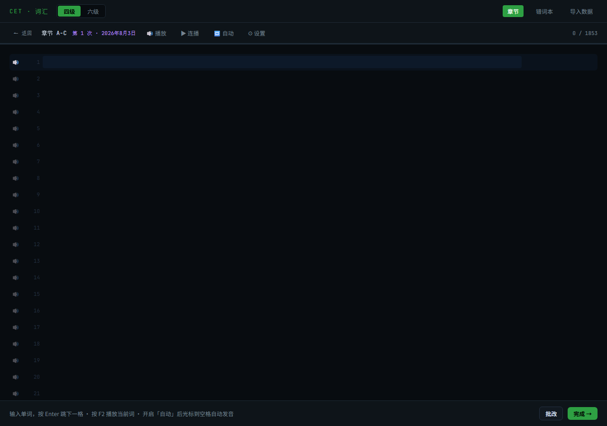

# 四六级词汇听写练习工具

一个为大学英语四六级（CET-4 / CET-6）听力备考设计的单词听写练习网页，内置英音/美音发音、乱序测试与随机百词测试。

**在线使用** → [点击这里](https://pipitang233.github.io/cet-dictation/)

---

## 功能

- 📚 **四级（7508 词）/ 六级（5651 词）双词库**，应用内一键切换，历史与错词本各自独立
- 🔊 **内置发音**：英音 / 美音可切换；浏览器无本地语音时自动切换到联网词典发音
- 🎲 **随机百词测试**：从当前词库全量随机抽取 100 词乱序听写，成绩计入历史
- 🔀 **章节乱序测试**：每个章节可打乱顺序听写，防止背顺序
- 📒 **错词本**：自动收录错词，按章节分组，支持重练
- 📈 **历史统计**：记录每次听写的正确率，折线图展示进步趋势
- 💾 **本地存储**：数据保存在浏览器 localStorage，无需账号、无需联网

---

## 使用方法

1. 打开页面，顶部选择「四级」或「六级」词库
2. 点击章节卡片进入详情页，选「开始听写」或「乱序测试」；或在首页点「🎲 随机百词」直接来一场全词库随机测试
3. 配合发音边听边打，Enter 跳下一格，完成后自动判分，错词进错词本

发音设置（⚙）：语速、每词重复次数、连播间隔、英音/美音、真人发音模式，设置自动保存。

---

## 数据说明

词汇数据整理自 [KyleBing/english-vocabulary](https://github.com/KyleBing/english-vocabulary)（基于大学英语四六级大纲词汇）。词汇版权归原出处所有，本工具仅限个人学习、非商用。

---

## 技术说明

- 单文件 HTML 应用（无依赖、无需安装），可离线使用，可直接部署到 GitHub Pages
- 发音：浏览器 TTS（优先本地所选口音）+ 有道/Google 在线词典音频兜底

## 更新记录

### v1.0（初始发布）

- 四级/六级双词库与切换，历史与错词本按词库隔离
- 内置发音（英音/美音切换、真人发音模式、测试语音）
- 章节乱序测试 + 全词库随机 100 词测试
- 错词本、历史统计、本地存储、GitHub Pages 展示页
